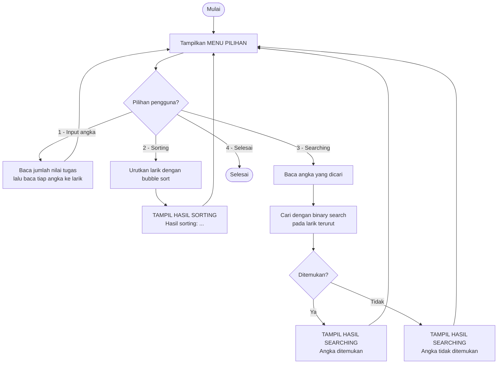

# Dokumen 07 — Flowchart & Pseudocode Algoritma (Unit J.620100.022.02)

Program demo algoritma pada `src/cli.py` (submenu Demo Algoritma) mengikuti persis tampilan soal: MENU PILIHAN 1 Input angka / 2 Sorting / 3 Searching / 4 Selesai.

## Flowchart program menu



Simbol yang dipakai: terminator (oval) untuk mulai/selesai, proses (persegi) untuk langkah, keputusan (belah ketupat) untuk percabangan, dan panah sebagai garis alir — simbol standar flowchart.

## Pseudocode bubble sort — O(n²), memori O(1)

```
PROSEDUR bubble_sort(larik A, jumlah n)
    ULANGI untuk i dari 0 sampai n-2
        ULANGI untuk j dari 0 sampai n-2-i
            JIKA A[j] > A[j+1] MAKA
                tukar A[j] dengan A[j+1]
            AKHIR JIKA
        AKHIR ULANGI
    AKHIR ULANGI
    KEMBALIKAN A
```
Contoh soal: input 70, 50, 90 → putaran membandingkan (70,50) tukar → (70,90) tetap → hasil sorting: 50, 70, 90.

## Pseudocode binary search — O(log n), syarat: data sudah terurut

```
FUNGSI binary_search(larik terurut A, dicari x) -> indeks atau -1
    kiri = 0; kanan = n - 1
    SELAMA kiri <= kanan
        tengah = (kiri + kanan) div 2
        JIKA A[tengah] == x MAKA KEMBALIKAN tengah
        JIKA A[tengah] < x MAKA kiri = tengah + 1
        SELAIN ITU kanan = tengah - 1
    AKHIR SELAMA
    KEMBALIKAN -1    (tidak ditemukan)
```

## Pseudocode linear search — O(n), tanpa syarat urutan

```
FUNGSI linear_search(larik A, dicari x) -> indeks atau -1
    ULANGI untuk i dari 0 sampai n-1
        JIKA A[i] == x MAKA KEMBALIKAN i
    AKHIR ULANGI
    KEMBALIKAN -1
```

## Ringkasan kompleksitas (untuk dihafal)
| Algoritma | Waktu | Memori | Syarat |
|---|---|---|---|
| Bubble sort | O(n²) | O(1) | — |
| Linear search | O(n) | O(1) | — |
| Binary search | O(log n) | O(1) iteratif | data terurut |

Kompleksitas waktu mengukur pertumbuhan jumlah operasi terhadap ukuran input; kompleksitas memori mengukur ruang tambahan di luar input itu sendiri.
